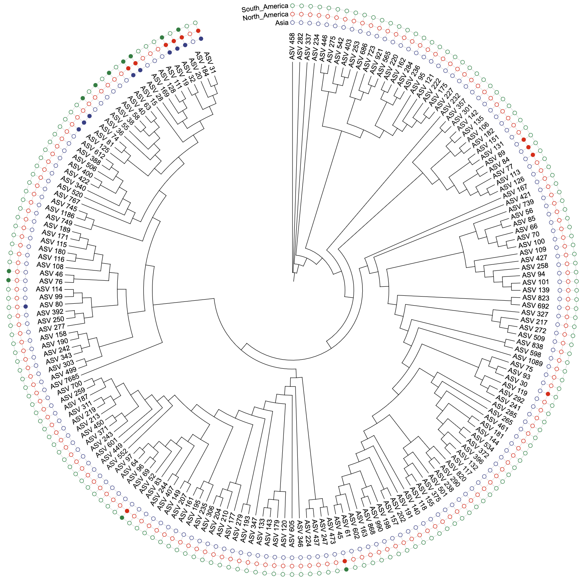
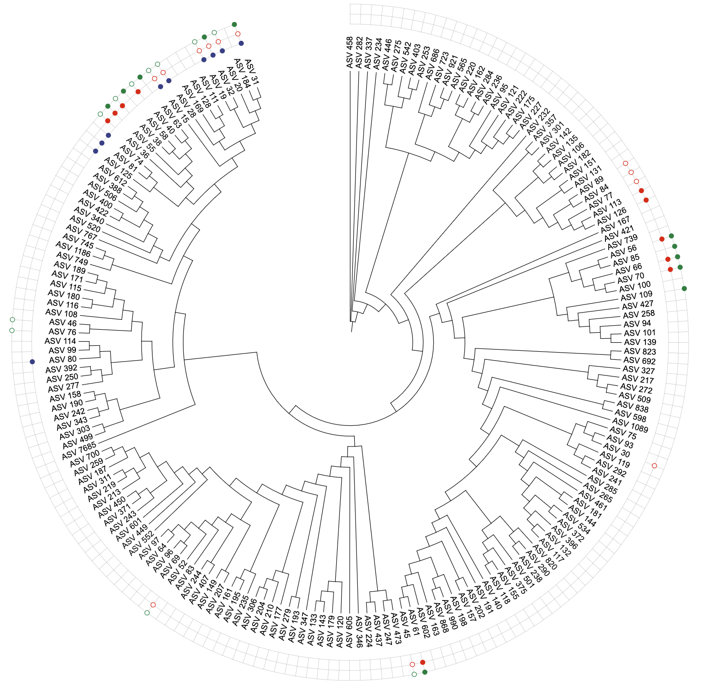
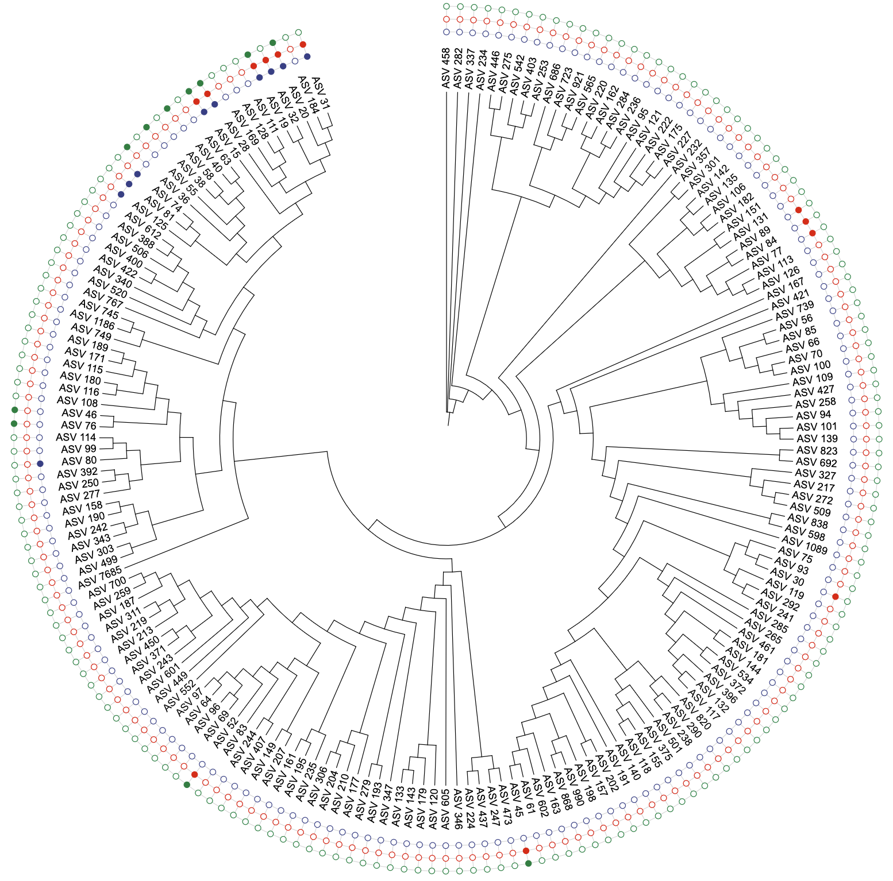
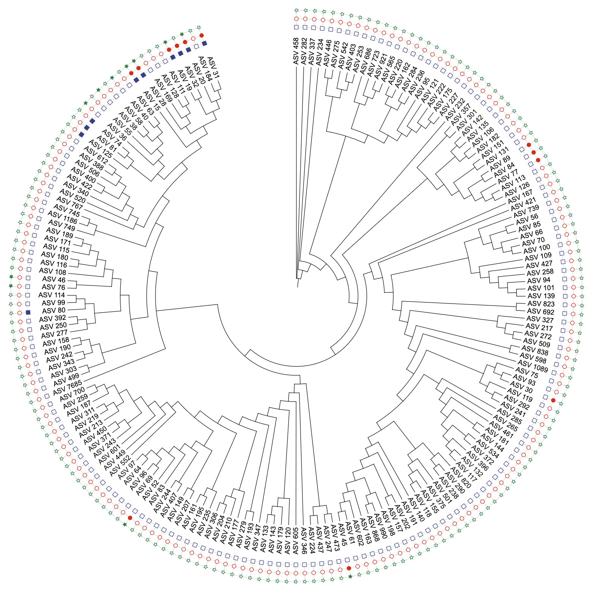
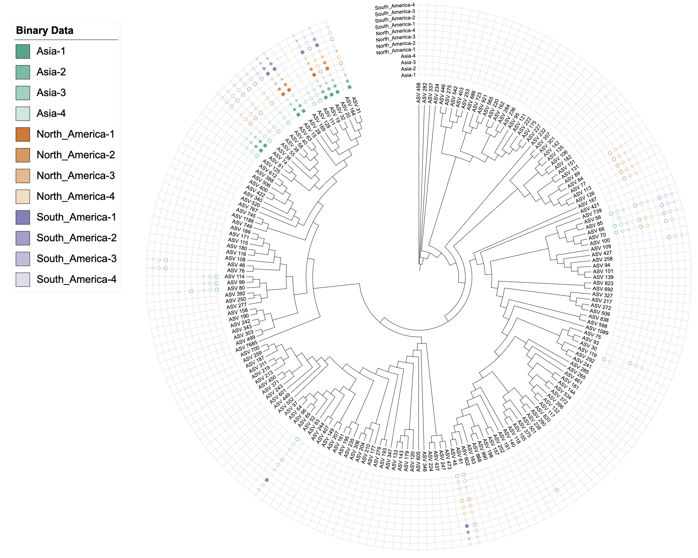
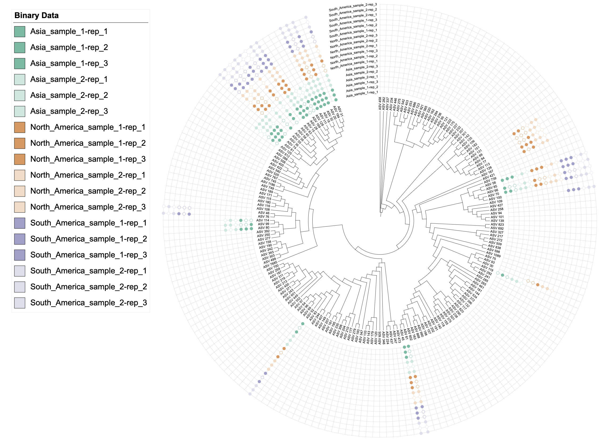
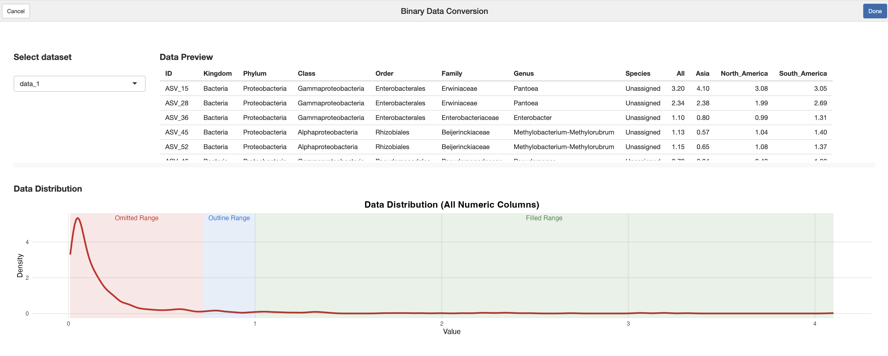
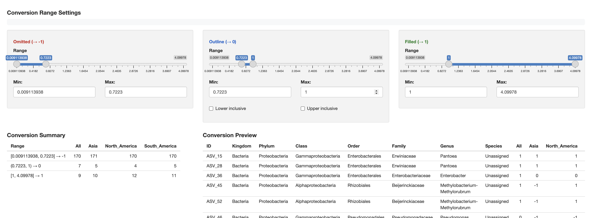
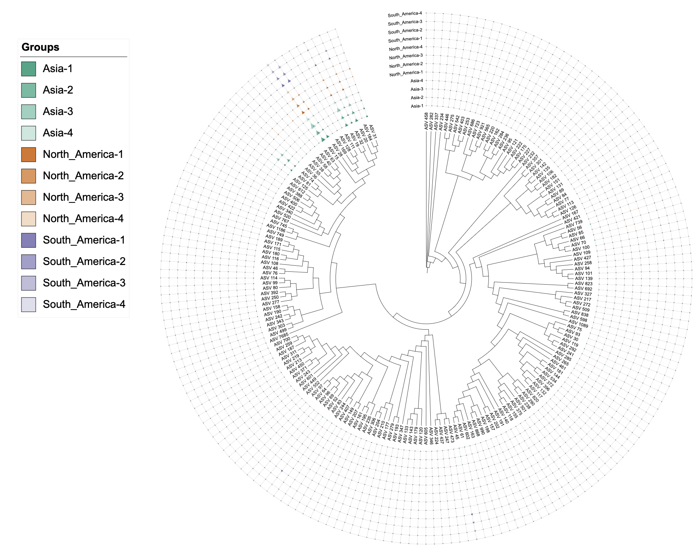
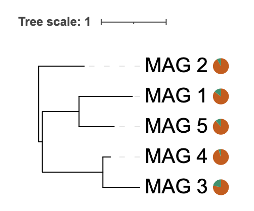

```{r, include = FALSE}
knitr::opts_chunk$set(
  collapse = TRUE,
  eval = FALSE,
  echo = TRUE,
  message = FALSE,
  warning = FALSE,
  comment = "#>"
)
```

# Overview

The `itol.toolkit` package version 1.2.2 continues the evolution of dual-factor coloring capabilities, extending support to additional template types and enhancing existing functionality. This version also includes important bug fixes for pie chart functionality.

Updates:

1. **Added:** `DATASET_BINARY` now supports third element color palette specification in dual-factor coloring.
2. **Added:** Flexible separator syntax for attribute-based dual-factor coloring - support any string as separator (single/multi-character, special regex characters).
3. **Added:** `DATASET_BINARY` now features flexible data conversion with a standalone `convert_to_binary()` function for precise control over binary data transformation.
4. **Added:** Interactive RStudio Addin `binary_data_conversion` provides an intuitive graphical interface for binary data conversion with real-time preview and range controls.
5. **Added:** `DATASET_EXTERNALSHAPE` now supports dual-factor coloring (main group + gradient) with customizable color palettes.
6. **Fixed:** `DATASET_PIECHART` now supports single-column data input with intelligent range detection and automatic pie segment generation.

## 1. DATASET_BINARY Enhanced Dual-Factor Coloring

Building upon the existing dual-factor coloring functionality in `DATASET_BINARY`, v1.2.2 introduces **flexible separator syntax** - the major innovation that allows any string to be used as a separator for grouping technical replicates. This version also adds support for specifying custom color palettes as the third element in the `color` parameter, and improved shape parameter control for independent shape assignment.

### Available dual-factor coloring approaches:

1. **Color-color dual-factor**: `color = c("main_factor", "gradient_factor")` - Two color columns for dual-factor coloring
2. **Color-color dual-factor with custom palette**: `color = c("main_factor", "gradient_factor", "palette_name")` - Custom color palette support
3. **Attribute-based coloring with separator**: `color = c("attr_name", "separator", "palette_name")` - Group technical replicates by separator in column names (separator can be any string, e.g., "-", "_", "sample", "_rep", etc.)
4. **Shape-color dual-factor**: `color = "gradient_factor", shape = "main_factor"` - Independent shape and color control

### Basic dual-factor coloring (existing functionality)

```{r}
library(itol.toolkit)
library(dplyr)
library(data.table)

# Load dataset4
tree_1 <- system.file("extdata","dataset4/otus.contree",package = "itol.toolkit")
data_file_1 <- system.file("extdata","dataset4/annotation.txt",package = "itol.toolkit")
data_1 <- data.table::fread(data_file_1)

# Select data columns
# Note: Manual conversion shown here for demonstration
# In v1.2.2+, automatic conversion is available (see Section 3)
data_original <- data_1 %>% 
  select(ID, Asia, North_America, South_America) 
data_binary <- data_original %>% 
  mutate(
    Asia = case_when(
      Asia >= 1 ~ 1,
      Asia < 1 ~ 0,
      Asia == 0  ~ -1
    ),
    North_America = case_when(
      North_America >= 1 ~ 1,
      North_America < 1 ~ 0,
      North_America == 0  ~ -1
    ),
    South_America = case_when(
      South_America >= 1 ~ 1,
      South_America < 1 ~ 0,
      South_America == 0  ~ -1
    )
  )

# Create unit with single-factor coloring after manuly covert binary data
u_binary_original <- create_unit(
  data = data_binary,
  key = "BINARY_original",
  type = "DATASET_BINARY",
  color = "aaas",
  tree = tree_1
)

write_unit(u_binary_original)
```


```{r}
# Create unit with single-factor coloring by auto covert binary data
u_binary_coverted <- create_unit(
  data = data_original,
  key = "BINARY_converted",
  type = "DATASET_BINARY",
  color = "aaas",
  method = "binary",
  tree = tree_1
)

write_unit(u_binary_coverted)
```


```{r}
# Create unit with single-factor coloring by 2 step method covert binary data
data_binary_2steps <- convert_to_binary(
  data_original,
  negative_range = c(0, 0),
  zero_range = c(0, 1),
  positive_range = c(1, Inf),
  lower_inclusive = FALSE,
  upper_inclusive = FALSE,
  auto_detect = FALSE,
  verbose = TRUE
)

u_binary_covert_2steps <- create_unit(
  data = data_binary_2steps,
  key = "BINARY_convert_2steps",
  type = "DATASET_BINARY",
  color = "aaas",
  tree = tree_1
)

write_unit(u_binary_covert_2steps)
```


```{r}
# Create unit with shapes
data_binary <- anno_col_group(data_binary, list(
  Asia = "Asia",
  North_America = "North_America",
  South_America = "South_America"),
  attr_name = "shape")

u_binary_shapes <- create_unit(
  data = data_binary,
  key = "BINARY_shapes",
  type = "DATASET_BINARY",
  color = "aaas",
  shape = "shape",
  tree = tree_1
)

write_unit(u_binary_shapes)

```




### Simulated binary data demonstration with group-based shapes

```{r}
# Function to generate fluctuating columns for demonstration
generate_fluctuation_columns <- function(df, base_col, num_cols, fluctuation_range, separator = "-", hierarchical = FALSE, num_samples = NULL) {
  set.seed(123)  # Ensure reproducible results
  
  if(hierarchical && !is.null(num_samples)){
    # Hierarchical naming: base_col_sample_#-rep_#
    for (sample in 1:num_samples) {
      for (rep in 1:num_cols) {
        col_name <- paste0(base_col, "_sample_", sample, separator, rep)
        df[[col_name]] <- df[[base_col]] * (1 + runif(nrow(df), -fluctuation_range, fluctuation_range))
      }
    }
  } else {
    # Simple naming: base_col-separator-#
  for (i in 1:num_cols) {
      col_name <- paste0(base_col, separator, i)
    df[[col_name]] <- df[[base_col]] * (1 + runif(nrow(df), -fluctuation_range, fluctuation_range))
    }
  }
  return(df)
}

# Prepare data for binary visualization
# Select relevant columns and generate multiple samples
data_3 <- data_1 %>% select(ID, Asia, North_America, South_America)

# Generate 4 columns for each region with ±15% fluctuation
data_3 <- generate_fluctuation_columns(data_3, "Asia", 4, 0.15)
data_3 <- generate_fluctuation_columns(data_3, "North_America", 4, 0.15)
data_3 <- generate_fluctuation_columns(data_3, "South_America", 4, 0.15)

# Round numeric values for cleaner visualization
data_3[, 2:ncol(data_3)] <- round(data_3[, 2:ncol(data_3)])


# Binary data conversion
data_3_binary <- convert_to_binary(
  data = data_3,
  force_convert = FALSE,
  verbose = TRUE,
  negative_range = c(0, 0),
  zero_range = c(0, 1),
  positive_range = c(1, 5),
  lower_inclusive = FALSE,
  upper_inclusive = TRUE,
  auto_detect = FALSE
)

# Add column group annotations using regular expressions
data_3_binary <- anno_col_group(data_3_binary, list(
  Asia = "^Asia",
  North_America = "^North_America",
  South_America = "^South_America"),
  attr_name = "color"
  )

data_3_binary <- anno_col_group(data_3_binary, list(
  s1 = "-1$",
  s2 = "-2$",
  s3 = "-3$",
  s4 = "-4$"),
  attr_name = "shape"
  )

# Create binary dataset unit with dual color and group-based shapes
# Using separator to group technical replicates
# Columns are named like "Asia-1", "Asia-2", "Asia-3", "Asia-4"
# Setting color = c("color", "-") uses prefixes before "-" as gradient groups
# All columns with same prefix (e.g., all "Asia-*") get the same gradient color
# The separator can be any string: "-", "_", "sample", "_rep", etc.
u_binary_colors_shapes <- create_unit(
  data = data_3_binary %>% select(-Asia, -North_America, -South_America),
  key = "BINARY_colors_shapes",
  type = "DATASET_BINARY",
  color = c("color", "-", "table2itol"),
  shape = "shape",  # Use group-based shape assignment
  tree = tree_1
)

write_unit(u_binary_colors_shapes)
```




## 2. Flexible Separator Syntax for Attribute-Based Dual-Factor Coloring

A key innovation in v1.2.2 is the support for flexible separator syntax in attribute-based dual-factor coloring. This allows users to group technical replicates using any string as a separator in column names, providing unprecedented flexibility for data naming conventions.

**Syntax**: `color = c("attr_name", "separator", "palette_name")`

Where the second element can be **any string** - single character, multi-character, or even special regex characters:

### Supported Separator Types

**1. Single Character Separators**

- Dash: `"-"` → groups `Asia-1`, `Asia-2` as same prefix

- Underscore: `"_"` → groups `Asia_1`, `Asia_2` as same prefix

- Dot: `"."` → groups `Asia.1`, `Asia.2` as same prefix

- Any other single character

**2. Multi-Character Separators**

- `"sample"` → groups `Asia_sample1`, `Asia_sample2` as same prefix

- `"-rep_"` → groups `Asia_sample_1-rep_1`, `Asia_sample_1-rep_2` as same prefix

- `"_batch"` → groups `Asia_batch1`, `Asia_batch2` as same prefix

- Any other multi-character string

**3. Special Regex Characters**

- Automatically escaped: `.`, `|`, `(`, `)`, `+`, `$`, `*`, `?`, `[`, `]`, `{`, `}`, `^`, `\`

- Examples: `"."`, `"("`, `"$"` → automatically handled by the system

```{r}
# Create example data with multiple technical replicates for this section
# Technical replicates should be more similar to each other than to replicates of other regions
data_3_sep_example <- data_3 %>% select(ID, Asia, North_America, South_America)

# Generate technical replicates with hierarchical structure to demonstrate prefix grouping
# Use hierarchical naming: Asia_sample_1-rep_1, Asia_sample_1-rep_2, Asia_sample_2-rep_1, etc.
# Setting color = c("color", "-rep_") will group by prefix before "-rep_"
# All columns with same prefix (e.g., all "Asia_sample_1-rep_*") will get the same gradient color
# This demonstrates that technical replicates (rep_*) of the same sample share the same color
data_3_sep_example <- generate_fluctuation_columns(data_3_sep_example, "Asia", 3, 0.05, separator = "-rep_", hierarchical = TRUE, num_samples = 2)
data_3_sep_example <- generate_fluctuation_columns(data_3_sep_example, "North_America", 3, 0.05, separator = "-rep_", hierarchical = TRUE, num_samples = 2)
data_3_sep_example <- generate_fluctuation_columns(data_3_sep_example, "South_America", 3, 0.05, separator = "-rep_", hierarchical = TRUE, num_samples = 2)

# Binary conversion
data_3_sep_example <- convert_to_binary(
  data = data_3_sep_example,
  force_convert = FALSE,
  verbose = TRUE,
  negative_range = c(0, 0),
  zero_range = c(0, 1),
  positive_range = c(1, 5),
  lower_inclusive = FALSE,
  upper_inclusive = TRUE,
  auto_detect = FALSE
)

# Add column group annotations
data_3_sep_example <- anno_col_group(data_3_sep_example, list(
  Asia = "^Asia",
  North_America = "^North_America",
  South_America = "^South_America"),
  attr_name = "color"
  )

# Example: Multi-character separator "-rep_"
# Columns like "Asia_sample_1-rep_1", "Asia_sample_1-rep_2", "Asia_sample_2-rep_1", etc.
# Setting color = c("color", "-rep_") groups by prefix before "-rep_"
# All columns with same prefix (e.g., all "Asia_sample_1-rep_*") get the same gradient color
# This clearly shows that technical replicates (rep_1, rep_2, rep_3) share the same gradient color
u_sep_dash <- create_unit(
  data = data_3_sep_example %>% select(-Asia, -North_America, -South_America),
  key = "BINARY_sep_dash", 
  type = "DATASET_BINARY",
  color = c("color", "-rep_", "table2itol"),  # Multi-character separator
  tree = tree_1
)

write_unit(u_sep_dash)
```




This separator syntax is particularly useful for:

- **Technical replicates**: Group multiple technical replicates that should share the same appearance

- **Batch experiments**: Organize data from different experimental batches

- **Time series**: Group measurements from the same time point

- **Any naming convention**: Adapt to your existing data naming patterns


## 3. DATASET_BINARY Data Conversion Enhancement

`DATASET_BINARY` now features flexible data conversion options. The conversion functionality has been extracted into a standalone `convert_to_binary()` function, providing users with more control over when and how data conversion is performed.

### Two Usage Approaches

#### Approach 1: Automatic Conversion in `create_unit()`
Use the `method = "binary"` parameter to trigger automatic conversion:

```{r}
# Automatic conversion during unit creation
u_auto_convert <- create_unit(
  data = data_original,  # Use data_original from example above
  key = "BINARY_auto_convert",
  type = "DATASET_BINARY",
  method = "binary",  # Enable automatic conversion
  color = "aaas",
  tree = tree_1
)
```

#### Approach 2: Manual Conversion with `convert_to_binary()`
Use the standalone function for more control:

```{r}
# Manual conversion with custom parameters
data_converted <- convert_to_binary(
  data = data_original,  # Use data_original from example above
  negative_range = c(0, 0),      # [0, 0] → -1
  zero_range = c(0, 1),          # (0, 1) → 0  
  positive_range = c(1, 10),    # [1, 10] → 1
  lower_inclusive = FALSE,       # Control boundary inclusion
  upper_inclusive = FALSE,
  verbose = TRUE                 # Show conversion summary
)

# Then create unit with pre-converted data
u_manual_convert <- create_unit(
  data = data_converted,
  key = "BINARY_manual_convert",
  type = "DATASET_BINARY",
  color = "aaas",
  tree = tree_1
)
```

### Supported Data Types and Conversion Rules

**1. Proportion Data (0-1 range)**

- **Detection**: Numeric data with all values in [0, 1]

- **Conversion**: 

  - `0` → `-1`

  - `< 0.5` → `0`

  - `≥ 0.5` → `1`

**2. Count/Other Non-negative Data**

- **Detection**: Numeric data with max value > 1, min value ≥ 0

- **Conversion**:

  - `0` → `-1`

  - `< 1` → `0`

  - `≥ 1` → `1`

**3. Boolean Data (Multiple Formats)**

- **Supported formats**: `TRUE/FALSE`, `T/F`, `true/false`, `"1"/"0"`, `yes/no`

- **Conversion**:

  - `TRUE/T/true/1/yes` → `1`

  - `FALSE/F/false/0/no` → `0`

**4. Already Binary Data**

- **Detection**: Data already in {-1, 0, 1} format

- **Action**: No conversion needed


### Conversion Summary Display

The `convert_to_binary()` function provides detailed conversion summaries:

```
Converting data to binary format (-1, 0, 1)...

Conversion Summary:
         Range Values1 Values2
        <char>   <num>   <num>
1: [0, 0] → -1       1       1
2:  (0, 1) → 0       2       2
3: [1, 10] → 1       2       2
```

## 4. Interactive Binary Data Conversion Addin

Version 1.2.2 introduces a powerful RStudio Addin that provides an intuitive graphical interface for binary data conversion. The `binary_data_conversion` Addin allows users to visually configure conversion ranges and preview results in real-time.

### Accessing the Addin

The Addin is accessible through RStudio's Addins menu:

- **Location**: RStudio Menu → Addins → Binary Data Conversion

- **Or** via R console: `itol.toolkit::binary_data_conversion()`

### Key Features

#### 1. Dynamic Range Configuration

- **Three Range Sliders**: Omitted (→ -1), Outline (→ 0), and Filled (→ 1)

- **Visual Density Plot**: Shows data distribution with colored range overlays

- **Direct Numerical Input**: Precision control with numeric input fields

- **Automatic Range Constraints**: Zero-gap boundaries prevent overlapping ranges

#### 2. Real-Time Preview

- **Data Preview**: Original data with current range settings

- **Conversion Preview**: Shows converted binary data instantly

- **Conversion Summary**: Displays conversion statistics for each column

#### 3. Smart Boundary Control

- **Lower/Upper Inclusive Checkboxes**: Fine-tune range boundaries

- **Dynamic Labels**: Range notation adapts based on inclusive/exclusive settings

  - `[a, b]` (both inclusive)

  - `(a, b]` (lower exclusive, upper inclusive)

  - `[a, b)` (lower inclusive, upper exclusive)

  - `(a, b)` (both exclusive)


### Usage Example

```{r}
# Access the Addin through RStudio menu
# or via R console:
itol.toolkit::binary_data_conversion()

# The Addin provides:
# 1. Dataset selection dropdown
# 2. Interactive range sliders for conversion
# 3. Real-time preview of converted data
# 4. Visual density distribution
# 5. Code generation button
```

### Workflow

1. **Select Dataset**: Choose from available data frames in the global environment

2. **Configure Ranges**: 

   - Adjust sliders to define conversion ranges

   - Use numeric inputs for precise values

   - Set boundary inclusivity for the middle range

3. **Preview Results**: 

   - View original data and converted results side-by-side

   - Check conversion summary statistics

   - Verify data distribution visualization

4. **Generate Code**: Click "Done" to insert R code into the active script




### Generated Code Format

```{r}
# Binary data conversion
converted_data <- convert_to_binary(
  data = your_dataset[, c("ID", "Col1", "Col2")],
  force_convert = FALSE,
  verbose = TRUE,
  negative_range = c(0.0, 0.5),
  zero_range = c(0.5, 1.0),
  positive_range = c(1.0, 4.1),
  lower_inclusive = FALSE,
  upper_inclusive = FALSE,
  auto_detect = FALSE
)
```


## 5. DATASET_EXTERNALSHAPE Dual-Factor Coloring

`DATASET_EXTERNALSHAPE` now supports dual-factor coloring, following the same strategy as other template types where the first factor serves as the main grouping, and the second factor creates gradients within each main group.

### Single factor coloring (existing functionality)

```{r}
# Add column group annotations for EXTERNALSHAPE
# Note: data_3 has columns like "Asia-1", "Asia-2", etc. (dash separator)
data_3_external <- anno_col_group(data_3, list(
  Asia = "^Asia",
  North_America = "^North_America",
  South_America = "^South_America"),
  attr_name = "color"
  )

# Single factor coloring with default palette
u_externalshape_single <- create_unit(
  data = data_3_external,
  key = "EXTERNALSHAPE_single",
  type = "DATASET_EXTERNALSHAPE",
  color = "table2itol",
  tree = tree_1
)

write_unit(u_externalshape_single)
```

### Dual-factor coloring with separator

```{r}
# Dual-factor coloring using attribute-based grouping with separator
# The separator can be any string (e.g., "-", "_", "sample", "_rep", etc.)
u_externalshape_dual <- create_unit(
  data = data_3_external %>% select(-Asia, -North_America, -South_America),
  key = "EXTERNALSHAPE_dual",
  type = "DATASET_EXTERNALSHAPE",
  color = c("color", "-", "table2itol"),  # Use "-" separator to group technical replicates
  tree = tree_1
)

write_unit(u_externalshape_dual)
```


## 6. DATASET_PIECHART Single-Column Support

### Problem Solved

Previously, `DATASET_PIECHART` required multiple columns to create different pie segments, causing errors when users provided single-column data (e.g., completeness percentages). The error `attempt to select less than one element in integerOneIndex` occurred because the color palette system expected multiple pie segments but received none.

### Solution Implemented

v1.2.2 now automatically detects single-column input and creates appropriate pie segments with intelligent range detection:

1. **Automatic Detection**: When only 2 columns are provided (ID + value), the system detects this as a single-column pie chart scenario

2. **Smart Range Detection**: Automatically determines the appropriate remainder calculation based on data range:

   - **0-1 range**: Creates remainder as `1 - value` (for proportion data)

   - **0-100 range**: Creates remainder as `100 - value` (for percentage data)

   - **Other ranges**: Defaults to percentage calculation `100 - value`

3. **Auto-Expansion**: Creates two pie segments automatically:

   - **Value**: The original data value

   - **Remainder**: Calculated based on detected data range

4. **Proper Structure**: Maintains correct iTOL pie chart format with POSITION, RADIUS, and two segments

5. **Color Handling**: Ensures proper color assignment with minimum palette requirements

### Usage Examples

#### Example 1: Percentage Data (0-100 range)
```{r}
library(itol.toolkit)
library(dplyr)

# Sample completeness data as percentages
meta_CheckM <- data.frame(
  MAG = paste0("MAG_", 1:5),
  Completeness = c(85.2, 92.1, 78.5, 95.3, 88.7),  # 0-100 range
  stringsAsFactors = FALSE
)

# Create tree
tree_big <- ape::rtree(5, tip.label = meta_CheckM$MAG)

# Automatically detects 0-100 range and creates remainder as (100 - value)
unit_41 <- create_unit(
  data = meta_CheckM %>% select(MAG, Completeness),
  key = "E041_piechart_percentage",
  type = "DATASET_PIECHART",
  position = -1,
  tree = tree_big
)

write_unit(unit_41)
```



#### Example 2: Proportion Data (0-1 range)
```{r}
# Sample completeness data as proportions
meta_CheckM_prop <- data.frame(
  MAG = paste0("MAG_", 1:5),
  Completeness = c(0.852, 0.921, 0.785, 0.953, 0.887),  # 0-1 range
  stringsAsFactors = FALSE
)

# Create tree
tree_big_prop <- ape::rtree(5, tip.label = meta_CheckM_prop$MAG)

# Automatically detects 0-1 range and creates remainder as (1 - value)
unit_41_prop <- create_unit(
  data = meta_CheckM_prop %>% select(MAG, Completeness),
  key = "E041_piechart_proportion",
  type = "DATASET_PIECHART",
  position = -1,
  tree = tree_big_prop
)

write_unit(unit_41_prop)
```

### Output Structure

The generated pie chart will show:

- Each MAG's completeness as one colored segment

- The remainder calculated based on detected data range:

  - For 0-1 range: remainder = 1 - value

  - For 0-100 range: remainder = 100 - value

- Proper field labels: "Value" and "Remainder"

- Appropriate color assignment from the default palette

- Automatic range detection messages in the console

### Backward Compatibility

This enhancement is fully backward compatible:

- Multi-column pie charts continue to work as before

- Single-column pie charts now work automatically with intelligent range detection

- No changes required to existing code using multi-column pie charts

- The system automatically handles both proportion (0-1) and percentage (0-100) data formats
